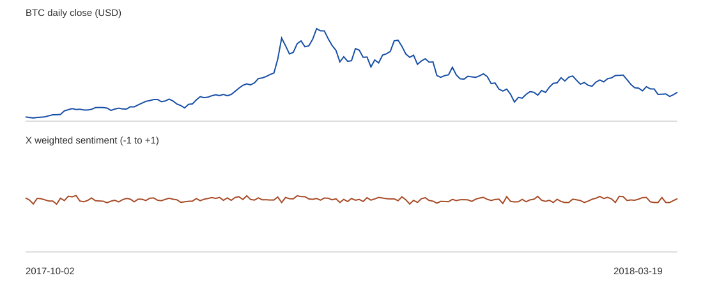

# Historical BTC X sentiment evaluation

## Provenance and scope

Source: [CrypTop12](https://github.com/am15h/CrypTop12), commit `f05691aeee35349c8adb02f17940b91a1531b399`, `tweet/preprocessed/btc/YYYY-MM-DD` and `price/raw/btc.csv`. We parsed each JSON-lines post, filtered Bitcoin/BTC terms, deduplicated by post ID, converted the source IST timestamps to UTC dates, scored text with the transparent lexicon in `cwt/model.py`, and capped engagement weights. `data/historical_daily.csv` holds the derived daily score, count and matching close. No raw tweets or credentials are redistributed. The source price series has matching bars from 2017-10-02 through 2018-03-19; 30677 matching posts across 169 daily bars. This is an archival experiment, **not** a recent 180-day scrape or current outlook.

## Timing and validation

Forecasts are issued after each UTC daily close. `n+0` is the observed close and is not scored as a forecast. For horizon h, a training label is used only if its closing date is no later than the issue date. Expanding Ridge models use price returns and past/current daily X sentiment and post volume only. The naive baseline predicts no price change. No test-set tuning was performed. The original price file does not document its exact close timestamp; this daily alignment is an assumption that needs source verification before intraday or live claims.

| Horizon | OOS n | X+price MAE | Price-only MAE | No-change MAE | X+price RMSE | Direction accuracy |
|---:|---:|---:|---:|---:|---:|---:|
| 1 | 108 | 754.65 | 716.37 | 673.12 | 1018.26 | 48.1% |
| 2 | 106 | 1153.40 | 1099.77 | 1020.19 | 1565.90 | 46.2% |
| 3 | 104 | 1510.55 | 1393.16 | 1267.77 | 1970.25 | 49.0% |
| 4 | 102 | 1689.81 | 1588.15 | 1410.55 | 2225.35 | 45.1% |
| 5 | 100 | 2011.53 | 1866.87 | 1499.18 | 2576.70 | 40.0% |

In this window, adding the simple X sentiment features increased MAE versus the price-only model at every horizon. Both fitted models lost to the no-change forecast. This is negative evidence for the current feature design, and a reason to improve data coverage and sentiment quality before using the model for a live decision.

## One-day idealized long/cash signal diagnostic

The position is long BTC when the one-day predicted return is positive and otherwise cash. The calculation assumes execution at the issue close and 10 bps per position change. Because the signal uses that completed close, exact execution there is generally unavailable. These metrics diagnose the signal; they are not an executable backtest. For 108 out-of-sample days: Sharpe -0.461, Sortino -0.701 if defined, maximum drawdown -64.53%, total return -28.58%, turnover 55. Sharpe uses sample daily standard deviation and √365; Sortino uses the root mean square of returns below zero. Drawdown is measured from a starting equity of 1. No slippage, financing or market impact is modeled.

## Historical sentiment outlook at the dataset end

On 2018-03-19 the weighted daily score was +0.083 from 156 posts. The trailing seven-day mean was +0.033, across 580 posts. The BTC close was $8,630.65. This statement describes March 2018 only. The current sentiment requires a fresh scrape and news retrieval.

## Limitations

Selection and scraping coverage, bot posts, lexicon ambiguity, timezone/bar conventions and the absence of slippage can materially alter conclusions. Price and sentiment may be contemporaneously correlated. A live strategy needs a feasible post-close fill rule and matching executable prices. The same corpus is not proof of present performance.

